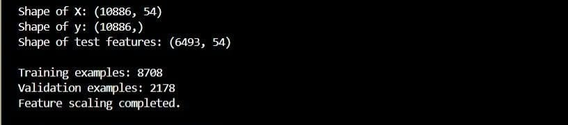
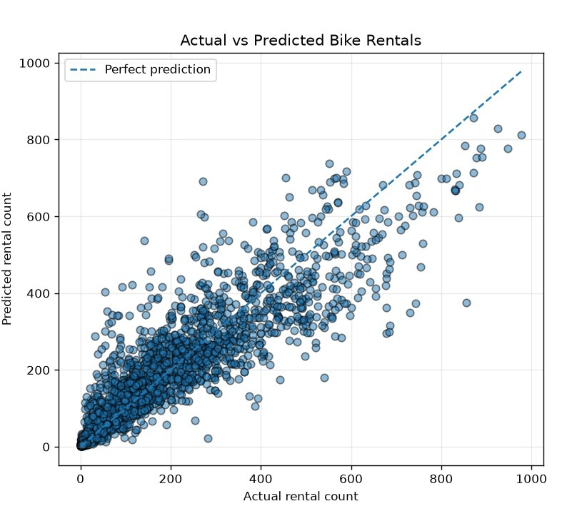
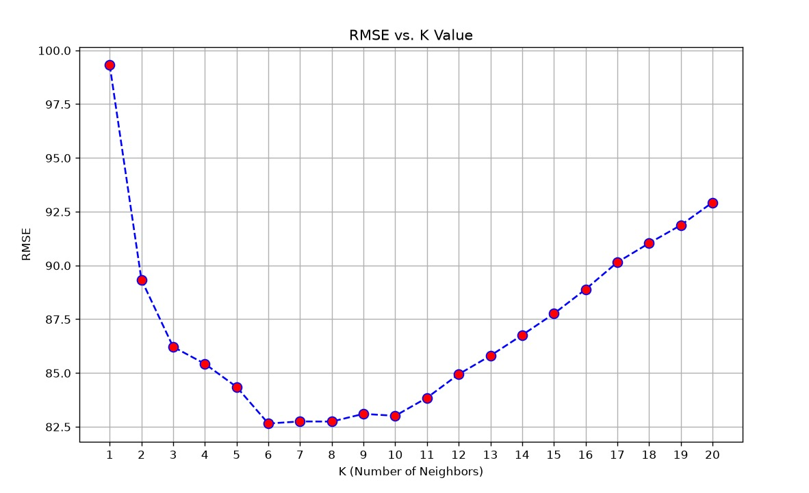
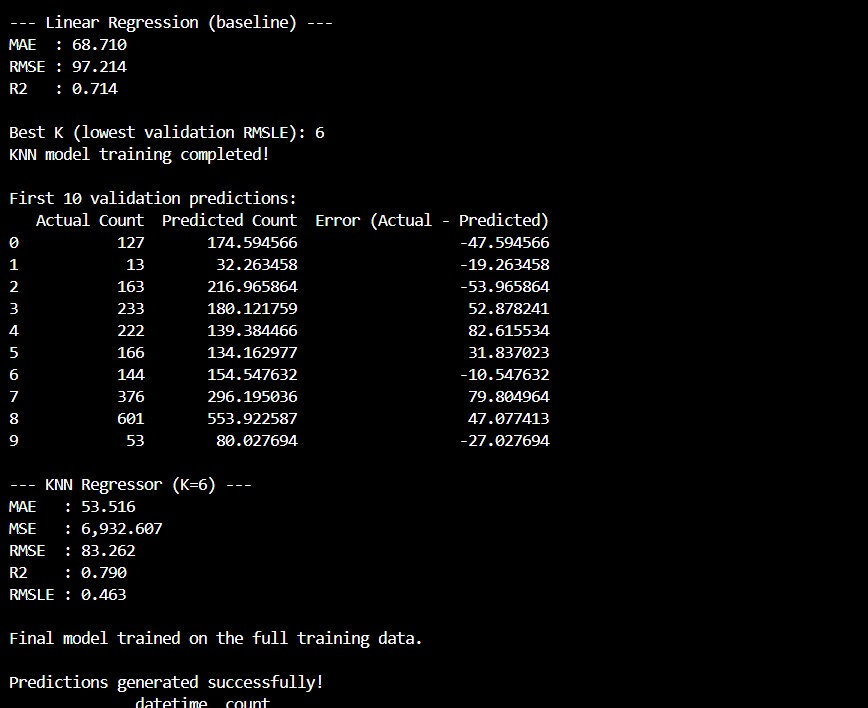

# Bike Rental Demand Prediction


## 🎯 Project Overview

This project aims to predict the number of bikes rented based on weather conditions and time-related factors such as **temperature, humidity, season and time of day etc.** using the Bike Sharing Demand dataset. It uses data preprocessing, exploratory data analysis, and Linear Regression to build a predictive model. The model's performance is evaluated using standard regression metrics to assess its accuracy and ability to estimate future bike rental demand.

## 👥 Team Members

| Name | Role | Entry No. | GitHub Username | 
| :--- | :--- | :--- | :--- |
| Vantala Venu Prathyush | Execution Lead | 2026AIB1090 | [@venuprathyush](https://github.com/venuprathyush) |
| Avishi Sood | Documentation Lead | 2026EEB1330 | [@2026eeb1330](https://github.com/2026eeb1330) |
| Mirgane Aditya Tanaji | Video Lead | 2026ESB1481 | [@Adi-09-dev](https://github.com/Adi-09-dev) |
| Pooja | PPT Lead | 2026MCB1554 | [@2026MCB1554](https://github.com/2026MCB1554) |

## 🚀 Objectives
- Analyse bike rental demand.
- Study the effect of weather and time.
- Develop a machine learning model to predict demand.
- 
## 📁 Project Structure

```
Bike-Rental-Demand-Prediction/
│
├── data/
│   ├── train.csv
│   ├── test.csv
│   └── sampleSubmission.csv
│
├── src/
│   ├── data_preprocessing.py
│   ├── data_analysis.py
│   ├── model_training.py
│   └── prediction.py
│
├── images/
│   ├── data_analysis.jpeg
│   ├── actual_vs_predicted.jpeg
│   ├── rmse_vs_k.jpeg
│   └── accuracy_parameters.jpeg
│
├── results/
│   ├── Actual vs Predicted Bike Rentals.png
│   ├── Actual vs Predicted.png
│   ├── Average Bike Rentals by Hour.png
│   ├── Bike Rental Count vs Humidity.png
│   ├── Bike Rental Count vs Temperature.png
│   ├── Distribution of Bike Rental Count.png
│   └── RMSE vs K Value.png
│
├── presentation/
│   └── Bike_Rental_Demand_Prediction.pdf
│
├── .gitignore
├── requirements.txt
└── README.md
```

## 🪜 Project Workflow

The complete workflow of the Bike Rental Demand Prediction system is shown below:
```text
Bike Sharing Dataset (train.csv / test.csv)
       |
       ↓
Data Loading & Cleaning
       |
       ↓
Exploratory Data Analysis 
       |
       ↓
Model Training (Linear Regression)
       |
       ↓
Model Evaluation & Visualizations
       |
       ↓
Bike Rental Demand Prediction
```


## ⚙️ Project Setup

The project uses Python and the following libraries: Pandas, NumPy, Matplotlib, and Scikit-learn. Python 3.11 or later is recommended.


### Clone the repository
``` bash
git clone https://github.com/2026eeb1330/Bike-Rental-Demand-Prediction.git
```
### Navigate to the project directory
``` bash
cd Bike-Rental-Demand-Prediction
```

### Create a virtual environment
``` bash
python -m venv venv
```

### Activate the virtual environment
### Windows:
``` bash
venv\Scripts\activate
```

### Linux/macOS:
``` bash
source venv/bin/activate
```

### Install the required libraries
``` bash
pip install -r requirements.txt
```

### Run data preprocessing
``` bash
python src/data_preprocessing.py
```

### Perform exploratory data analysis
``` bash
python src/data_analysis.py
```

### Train and evaluate the model
``` bash
python src/model_training.py
```

### Generate bike rental demand predictions
``` bash
python src/prediction.py
```


## 📊 Results and Visualisations

### Data Analysis



### Actual vs Predicted Bike Rentals



### RMSE vs K-Value



### Accuracy Parameters



## 📽️ Presentation and Video

-  **Project Presentation:** [Click here to view the PPT](presentation/Bike_Rental_Demand_Prediction.pdf)
-  **Project Demonstration Video:** [Click here to watch the video](https://drive.google.com/file/d/1jgGWw_mZjpPleEnnEWVKYVaPnMQt1_vc/view?usp=drive_link)

## 💡AI Usage Disclosure
AI tools were used during the project for:
- Documentation Improvement and README Understanding
- Assistance in Code and Presentation
- Debugging Support
  
Tools Used:

- ChatGPT
- Claude
- Gemini
  
The model training, code verification & implementation and evaluation was done by the team. 
